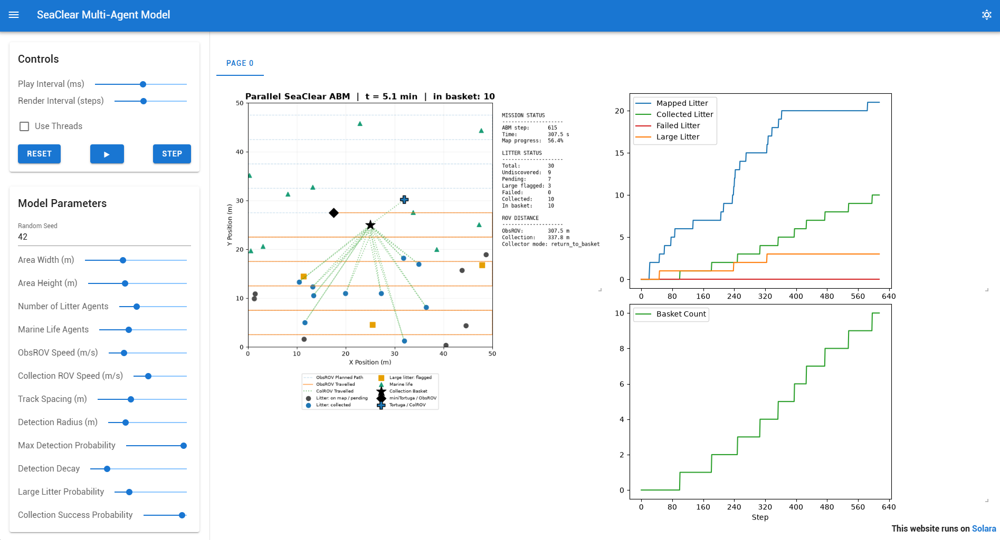

# SeaClear Mesa ABM

A simplified 2D Agent-Based Model (ABM) of underwater litter mapping and collection inspired by the **SeaClear** multi-robot marine litter cleanup system.

The current simulation models parallel operation between an Observation ROV (ObsROV) and a Collection ROV (ColROV), together with litter agents, marine-life agents, and a collection basket. It is implemented using the [Mesa](https://mesa.readthedocs.io/) agent-based modelling framework and visualised through a Solara browser interface.

## Simulation Preview



## Project Context

This project was developed for:

**TEB2103 – Modelling and Simulation**
The model is inspired by the SeaClear robotic architecture, which uses coordinated surface, aerial, and underwater robotic systems for detecting and collecting marine litter.

This implementation intentionally models only a simplified part of the complete SeaClear workflow.

## Current Scope

The current model represents:

- a two-dimensional underwater search area;
- one ObsROV (miniTortuga);
- one ColROV (Tortuga);
- multiple litter agents with lifecycle states;
- large litter that is detected and flagged but not collected;
- a stationary collection basket;
- marine-life agents with simple random movement;
- a predefined lawnmower mapping trajectory;
- parallel litter mapping and collection;
- continuous spatial positioning using Mesa `ContinuousSpace`;
- distance-based probabilistic litter sensing;
- probabilistic litter collection;
- browser-based live visualisation;
- configurable simulation parameters; and
- model-level time-series data collection.

The following remain outside the current scope:

- 3D underwater physics;
- hydrodynamic modelling;
- tether dynamics;
- ROS or Gazebo;
- real sonar simulation;
- computer vision / YOLO;
- USV behaviour;
- UAV behaviour;
- Collection ROV behaviour;
- physical litter retrieval.

## Model Architecture

The model currently contains five agent types.

### Observation ROV Agent

The ObsROV:

1. follows a lawnmower search trajectory;
2. senses nearby litter agents;
3. performs probabilistic detection; and
4. changes successfully detected litter from `UNDISCOVERED` to `ON_MAP`.

### Collection ROV Agent

The ColROV:

1. searches for mapped normal-sized litter;
2. selects the nearest eligible target;
3. travels toward the target;
4. performs a probabilistic collection attempt;
5. returns successfully collected litter to the basket; and
6. repeats until no eligible mapped litter remains.

### Litter Agent

Each litter agent contains:

- a spatial position;
- a lifecycle state;
- detection information;
- collection information;
- number of collection attempts; and
- an `is_large` property.

Litter lifecycle:

```text
    UNDISCOVERED
          ↓
  ObsROV detects litter
          ↓
        ON_MAP
          ↓
    ┌─────┴─────┐
    │           │
 large        normal
    │           │
 FLAGGED  ColROV selects
                ↓
           travel to item
                ↓
        collection attempt
            /        \
         success    failure
            │          │
        PICKED_UP    FAILED
            │
       return basket
            │
         deposit
            │
        COLLECTED
```

### Basket Agent

The stationary basket records the number of litter objects successfully deposited by the ColROV.

### Marine-Life Agent

Marine-life agents perform simple bounded random movement within the underwater environment. They currently provide environmental activity but do not yet affect ROV navigation.

## Environment

The environment uses Mesa's `ContinuousSpace`.

Default environment:

```text
Width:  50 m
Height: 50 m
```

The Observation ROV and all litter objects are registered as agents within this continuous two-dimensional space.

## Search Pattern

The Observation ROV follows a lawnmower search trajectory.

Conceptually:

```text
------------------------------------------------->
<-------------------------------------------------
------------------------------------------------->
<-------------------------------------------------
------------------------------------------------->
```

The default track spacing is:

```text
5 m
```

and the ROV advances along the planned trajectory in discrete movement increments.

## Detection Model

A litter agent must first fall within the ROV detection radius.

The probability of successful detection is modelled as:

```text
P(d) = Pmax × exp(-k × d)
```

where:

- `d` is the distance between the ROV and litter;
- `Pmax` is the maximum detection probability; and
- `k` is the detection-decay coefficient.

Default parameters:

```text
Detection radius:             3.0 m
Maximum detection probability: 0.95
Detection decay:               0.18
```

This provides a simplified abstraction of real sonar, camera, visibility, and object-detection performance.

## Default Simulation Parameters

| Parameter | Default |
| --- | ---: |
| Area width | 50 m |
| Area height | 50 m |
| Litter agents | 20 |
| ROV speed | 1.0 m/s |
| Track spacing | 5.0 m |
| Movement step | 0.5 m |
| Detection radius | 3.0 m |
| Maximum detection probability | 0.95 |
| Detection decay | 0.18 |
| Random seed | 42 |

## Repository Structure

```text
seaclear-mesa-abm/
│
├── seaclear/
│   ├── __init__.py
│   ├── agents.py
│   └── model.py
│
├── docs/
│   └── images/
│       └── seaclear-dashboard.png
│
├── app.py
├── requirements.txt
├── .gitignore
├── LICENSE
└── README.md
```

### `seaclear/agents.py`

Contains:

- `LitterAgent`
- `ObservationROVAgent`

### `seaclear/model.py`

Contains:

- `SeaClearModel`
- continuous-space configuration
- lawnmower path generation
- simulation stepping
- statistics
- Mesa DataCollector configuration

### `app.py`

Contains:

- Mesa/Solara visualisation;
- configurable model parameters;
- spatial simulation rendering; and
- results visualisation.

## Installation

### 1. Clone the repository

```bash
git clone https://github.com/syedmuhdhafidz/seaclear-mesa-abm.git
cd seaclear-mesa-abm
```

### 2. Create a virtual environment

Windows:

```powershell
python -m venv .venv
.venv\Scripts\Activate.ps1
```

Linux/macOS:

```bash
python3 -m venv .venv
source .venv/bin/activate
```

### 3. Install dependencies

```bash
pip install -r requirements.txt
```

## Running the Simulation

Start the Solara application:

```bash
solara run app.py
```

Then open:

```text
http://localhost:8765
```

in a web browser.

## Simulation Controls

The interface provides:

- **RESET** – recreate the simulation;
- **PLAY** – continuously advance the model;
- **STEP** – advance by one model step;
- **Play Interval** – control playback speed; and
- **Render Interval** – control visualisation refresh frequency.

The model parameters can also be changed from the sidebar before resetting the model.

## Output Metrics

The model tracks:

- mapped litter;
- undiscovered litter;
- pending litter;
- collected litter;
- failed collection attempts;
- large flagged litter;
- litter deposited in the basket;
- Observation ROV distance travelled;
- Collection ROV distance travelled;
- simulated mission time; and
- mapping progress.

Mesa's `DataCollector` stores these values across simulation steps for later analysis.

## Example Baseline Run

Using the default parameters and random seed `42`:

```text
Simulation steps: 1090
Distance travelled: 545.0 m
Mission time: 545.0 s
```

The exact detection behaviour depends on the stochastic detection model and simulation configuration.

## Technologies

- Python
- Mesa 3.5.1
- Mesa ContinuousSpace
- Solara
- NumPy
- Matplotlib
- pandas

## Known Dependency Compatibility

The project currently uses:

```text
Mesa:       3.5.1
Solara:     1.64.0
ipyvue:     1.13.0
ipyvuetify: 1.12.0
```

`ipyvue` and `ipyvuetify` are currently pinned to the compatible 1.x versions because incompatible newer releases may result in the Mesa/Solara sidebar loading while the simulation visualisation remains blank.

## Future Work

Possible extensions include:

- repeated-run / Monte Carlo experiments;
- track-spacing optimisation;
- water-turbidity modelling;
- energy-consumption modelling;
- Observation ROV localization uncertainty;
- USV and UAV agents;
- multi-agent task allocation;
- sensor fusion; and
- higher-fidelity underwater dynamics.

## Authors

- Syed
- Mahendra
- Iman
- Ria
- Amirul

## References

This project is inspired by the SeaClear research project and its multi-robot approach to autonomous underwater marine-litter detection and collection.

Mesa:
> ter Hoeven, E., Kwakkel, J., Hess, V., Pike, T., Wang, B., rht, & Kazil, J. (2025). Mesa 3: Agent-based modeling with Python in 2025. *Journal of Open Source Software, 10*(107), 7668. [https://doi.org/10.21105/joss.07668](https://doi.org/10.21105/joss.07668)

Mesa project:
[https://github.com/mesa/mesa](https://github.com/mesa/mesa)

## License

This project is licensed under the MIT License.
